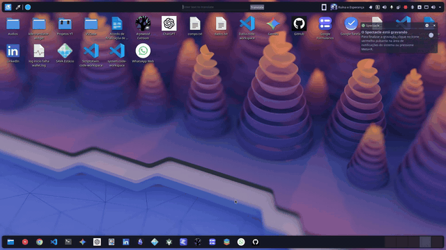
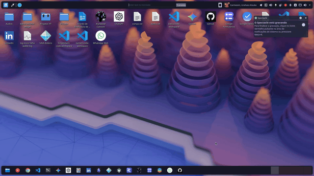
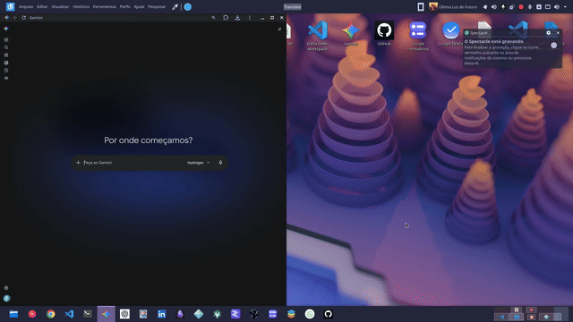

# Dalila — Regras de posicionamento de janelas


## O que é
Dalila é um script para KWin 6 que aplica regras de posicionamento às janelas de aplicativos na inicialização do aplicativo. Ele pode enviar uma janela para um ***monitor*** e uma ***área de trabalho virtual*** **específica** quando ela é aberta
# Desativado
 
 
# Ativado

 

## Funcionalidades
- Configure em **Gerenciamento de Janelas → Scripts do KWin**.
	- Seleção do monitor pelo número na lista atual de saídas do KWin: `0` mantém o monitor atual; `1` é a primeira saída, `2` a segunda e assim por diante.
	- Seleção da área de trabalho: `0` mantém a área atual; números positivos indicam a área de destino.
- Dez regras configuráveis, inicialmente vazias; configure apenas os aplicativos que quiser.
#### Observações
- Identificação por trecho de `resourceClass`, `desktopFileName` ou título da janela. A busca ignora maiúsculas e minúsculas; aliases podem ser separados por ponto e vírgula.
- Verificação de janelas já abertas ao iniciar e acompanhamento de novas janelas.
- Registro no log do mapeamento entre número e nome dos monitores e das regras aplicadas.
- O número do monitor segue a ordem atual de `workspace.screens` no KWin e pode mudar quando a configuração de telas mudar. Confira o log para ver qual nome corresponde a cada número.
## Instalação
#### Requisitos: 
 - KDE Plasma 6, KWin 6 e os comandos `kwriteconfig6`, `kreadconfig6` e `qdbus6` disponíveis.
#### Via  `.kwinscript` gerado em outro sistema, use:

```sh
kpackagetool6 --type=KWin/Script --install dist/Dalila.kwinscript
```

Depois da instalação do arquivo, ative e recarregue o script:

```sh
kwriteconfig6 --file kwinrc --group Plugins --key dalilaEnabled true
qdbus6 org.kde.KWin /KWin reconfigure
```

Abra **Configurações do Sistema → Gerenciamento de Janelas → Scripts do KWin** e use o botão de configuração do Dalila para editar as regras. Se houver scripts antigos para os mesmos aplicativos, mantenha-os desativados para evitar que disputem o posicionamento.


#### Caso de reinstalação
Para instalar diretamente neste usuário, preservando as regras já salvas no ID antigo, execute:
```sh
bash /mnt/DADOS/VSCode/Dalila/scripts/install-direct.sh
```

## Desenvolvendo
#### instalação via depurador do VSCode
Também é possível selecionar **Instalar e recarregar Dalila no KWin** em **Executar e Depurar** no VS Code. Esse perfil migra as regras do ID antigo `app-placement-rules` para `dalila` uma única vez e preserva configurações já existentes no Dalila. 
No VS Code, abra **Executar e Depurar** e selecione um dos perfis:
##### `launch.json`
- **Empacotar Dalila (.kwinscript):** gera `dist/Dalila.kwinscript` (requer `zip`).
- **Instalar e recarregar Dalila no KWin:** copia os arquivos para `~/.local/share/kwin/scripts/dalila`, ativa o novo ID e desativa `app-placement-rules`. A instalação antiga é mantida para reversão. O script é recarregado pelo D-Bus; o compositor não é reiniciado.
## Possíveis problemas
- **A regra não reconhece o aplicativo:** use um trecho que apareça em `resourceClass`, `desktopFileName` ou no título da janela. Para várias alternativas, separe os trechos com `;`. As regras são testadas de cima para baixo; a primeira correspondência é usada.
- **A janela não muda de monitor:** `0` desativa a movimentação de monitor. Verifique o número no log; se ele exceder a quantidade de telas conectadas, o KWin registra um aviso e mantém a janela na saída atual.
- **A janela não muda de área:** `0` mantém a área atual. Confira se a área informada existe no KWin.
- **O aplicativo inicia na bandeja:** ícones de bandeja não são janelas normais gerenciadas pelo KWin. A regra só pode agir quando a janela principal aparecer; abrir a janela pelo ícone da bandeja gera esse evento.
- **Uma regra alterada não afeta uma janela já tratada:** feche e abra a janela novamente ou recarregue o script. O script processa janelas no início e quando são criadas, e não reaplica continuamente as regras.
- **A numeração dos monitores mudou:** reconexões ou alterações na disposição das telas podem mudar a ordem fornecida pelo KWin. Consulte o novo mapa no log e ajuste os números no formulário.

Para consultar os registros da sessão:
```sh
journalctl --user -b --no-pager | grep '\[dalila\]'
```
## Fluxo de uso
1. Abra a configuração do Dalila na lista de Scripts do KWin.
2. Descubra um identificador da janela por um destes métodos:
   - **Console do KWin (X11 ou Wayland):** abra o KRunner com `Alt+F2`, procure `wm console` e execute este trecho para listar os dados das janelas abertas:

     ```js
     var windows = workspace.windowList();
     for (var i = 0; i < windows.length; i++) {
       var w = windows[i];
       print("[dalila-identificadores] resourceClass=" + w.resourceClass +
         " | desktopFileName=" + w.desktopFileName +
         " | caption=" + w.caption);
     }
     ```

     Consulte a saída no journal:

     ```sh
     journalctl --user -b --no-pager | grep '\[dalila-identificadores\]'
     ```

   - **X11:** execute `xprop WM_CLASS` em um terminal e clique na janela desejada. Use como pista o valor de classe mostrado; `xprop` não identifica janelas Wayland nativas.
   - opção interna
   
 

3. Na linha do aplicativo, informe um trecho exclusivo de `resourceClass`, `desktopFileName` ou `caption` (título). A busca ignora maiúsculas/minúsculas; para cadastrar alternativas na mesma regra, separe os trechos com `;`. Um campo vazio deixa a regra desativada.
4. Escolha o monitor (`0` para manter o atual) e a área de trabalho (`0` para manter a atual).
5. Salve as alterações. As regras são armazenadas na configuração do KWin.
6. Se já havia regras salvas de uma versão anterior, elas permanecem na configuração. Para removê-las, limpe o identificador, deixe monitor e área em `0` e salve.
7. Ao surgir uma janela, o KWin compara os identificadores com as regras, usa a primeira correspondência e aplica os destinos configurados.
8. Se o resultado não for o esperado, consulte o log para confirmar a regra reconhecida e a numeração atual das telas.

O console do KWin pode ser aberto também com `plasma-interactiveconsole --kwin`. Consulte a [documentação da API do KWin](https://develop.kde.org/docs/plasma/kwin/api/) para detalhes sobre `resourceClass`, `desktopFileName` e `caption`.
